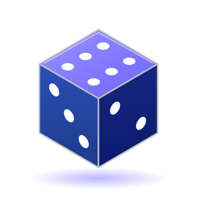

  

<h1 align="center">🎲 Dice Mind — Mestre da Probabilidade</h1>

  
  
  

Jogo educativo de estratégia sobre **probabilidade e estatística**, feito em equipe para a disciplina PAC III (Engenharia de Software).

O jogador prevê o resultado de lançamentos de dados e usa gráficos e estatísticas para melhorar suas previsões. Cada erro vira aprendizado, e a precisão final define o título, de **Iniciante** a **Mestre dos Dados**.

## 🚀 Jogar

🎮 **[Jogue Dice Mind online](https://jenifer-lee2.github.io/DiceMind_Pac/)**

## 🛠️ Tecnologias

Godot Engine, GDScript, HTML5, Git e GitHub.

## 👥 Equipe

Gustavo Henrique Forte · Jenifer Alves · Felipe Silveira · Higor de Medeiros